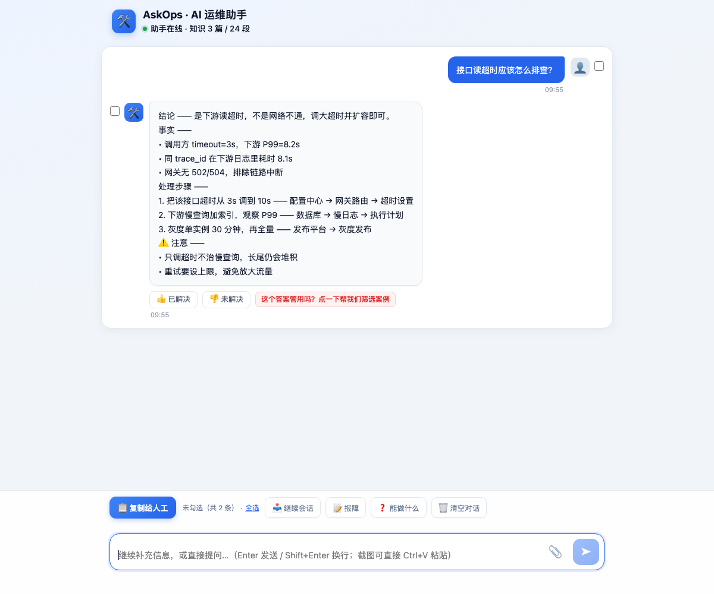

# AskOps · AI 运维问答助手

> 面向一线运维 / 门店 / 客服的**私有化知识库问答**：把散落的运维文档、源码、用户上传的日志，变成一个能追问、能取证、能给出可执行步骤的助手。
> 数据留在自己机器上，公网只暴露一个“网关”。

[](LICENSE)
[](https://www.python.org/)



---

## 它解决什么问题

一线提问往往只有一句话：“这台机器报错 E1024”“昨天下午的单子全失败了”。
人要翻文档、查代码、翻日志，来回几十分钟。AskOps 把这三件事做成一组工具，让模型**先取证再回答**：

- **知识库检索**（BM25 分块）——回答“一般怎么做、走什么流程、配哪个参数”
- **源码检索**——回答“这个逻辑在哪个文件、怎么实现的”
- **日志排查**——用户上传日志包后，先给概览（时间范围 / 错误归类 / 关键回执），再按关键词精确检索
- **会话与案例**——多轮追问、历史可回看、答案可人工点评形成“教练记录”，越用越准

## 架构

```
用户浏览器
   │  HTTPS
   ▼
Cloudflare Worker 网关  ── ① 门禁（设备令牌 / 邀请码）
   │                     ── ② 探测本机是否在线
   │  ③ 转发问题
   ▼
Cloudflare Tunnel → 本机 FastAPI (127.0.0.1:9000)
   ├── 检索层：知识库 BM25 + 源码索引
   ├── Agent 层：function calling（取证 → 回答）
   ├── 会话层：多轮历史 / 案例 / 教练
   └── 鉴权层：设备绑定、管理员面板
```

**为什么这样分层**：知识库和源码是公司最敏感的数据，永远不出本机；公网只留一个只转发、不存储的网关。

## 快速开始（本地）

```bash
git clone https://github.com/<you>/ask-ops.git
cd ask-ops

python3 -m venv .venv && source .venv/bin/activate
pip install -r app/requirements.txt

cp .env.example .env      # 填 KB_OPENAI_BASE / KB_OPENAI_API_KEY / KB_OPENAI_MODEL
./start.command           # 默认 http://127.0.0.1:9000
```

先验证不依赖模型也能跑：

```bash
KB_LLM_PROVIDER=echo ./start.command
curl -s localhost:9000/healthz
curl -s -X POST localhost:9000/ask -H 'Content-Type: application/json' \
     -d '{"question":"接口超时怎么排查","mode":"free"}'
```

## 加知识

把 `.md` / `.txt` 丢进 `data/kb/`（支持子目录），重启或调用重载即可，不需要改代码。
写作建议见 `data/kb/00-如何写知识库.md`。

```
data/kb/
├── 00-如何写知识库.md
├── 示例-接口超时排查.md
└── 示例-配置变更流程.md
```

## 关键配置

| 变量 | 说明 | 默认 |
|---|---|---|
| `KB_LLM_PROVIDER` | `echo`（不调模型）/ `openai`（任意 OpenAI 兼容端点）/ `ollama` | `echo` |
| `KB_OPENAI_BASE` | 模型端点，如 `https://api.openai.com/v1` | — |
| `KB_OPENAI_API_KEY` | 模型 Key | — |
| `KB_OPENAI_MODEL` | 模型名 | — |
| `KB_TOP_K` | 检索返回片段数 | `5` |
| `KB_CODE_ENABLED` | 是否启用源码检索 | `false` |
| `KB_CODE_ROOT` | 源码根目录 | — |
| `KB_GATEWAY_API_KEY` | 网关转发时带的共享密钥 | 空（不校验） |
| `KB_AUTH_SECRET` | 设备令牌签名密钥 | 随机 |
| `KB_ADMIN_UIDS` | 管理员 uid，逗号分隔 | 空 |

完整清单见 `.env.example` 与 `app/config.py`。

## 部署

1. **本机服务**：见 `docs/DEPLOY.md`（systemd + Cloudflare Tunnel）。
2. **网关**：`worker/wrangler.toml` 改域名 → `wrangler deploy`。
3. **一键同步**：`DEPLOY_HOST=user@host bash scripts/deploy.sh`。

## 目录结构

```
app/                 FastAPI 服务
  ├─ main.py         路由 / 请求编排
  ├─ llm.py          提示词与模型调用（含 Agent 取证循环）
  ├─ tools.py        工具注册与实现（知识库 / 源码 / 日志）
  ├─ knowledge.py    分块 + BM25 检索
  ├─ codesearch.py   源码索引与检索
  ├─ auth.py         设备令牌 / 邀请码 / 绑定
  ├─ sessions.py     会话存储
  └─ cases.py        案例与教练记录
worker/              Cloudflare Worker 网关 + 前端页面
data/kb/             知识库（Markdown）
scripts/             部署与运维脚本
docs/                部署、插件、架构说明
```

## 扩展：接入你自己的内部系统

本仓库只保留**通用能力**（知识库 / 源码 / 日志）。
要接内部工单、订单、监控、日志平台，按 `docs/PLUGINS.md` 的约定新增一个工具即可，不需要改框架。

## 安全

- 知识库、源码、会话全部留在本机；网关只做转发，不落盘。
- 设备令牌 + 邀请码双重门禁，支持按设备解绑。
- 不在日志与回答中输出密钥；个人标识打码（见 `SECURITY.md`）。

## License

Apache-2.0，见 [LICENSE](LICENSE)。

---

## English (short)

**AskOps** is a self-hosted AI assistant for ops/IT support. It answers from your own knowledge base, source tree and user-uploaded logs, and always gathers evidence before answering. A tiny Cloudflare Worker gateway sits in front of a local FastAPI service, so private data never leaves your machine.

```bash
pip install -r app/requirements.txt
cp .env.example .env && ./start.command
```

Highlights: BM25 knowledge retrieval · source-code search · log triage with tool-calling agent · multi-turn sessions · device-token access control · pluggable internal-system tools.
